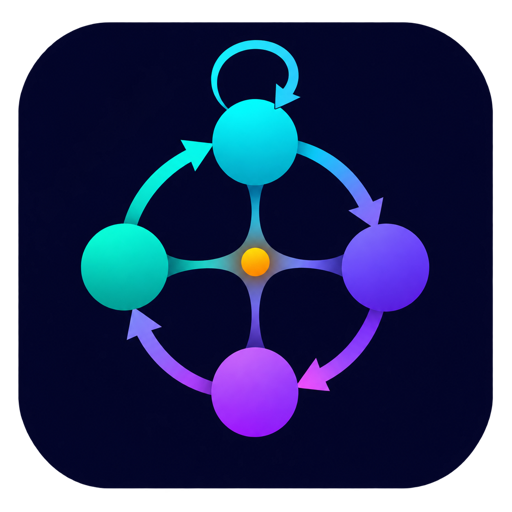

<p align="center">
  
</p>

# Adaptive Occupancy Simulator

AOS is a local Home Assistant custom integration that learns joint household lighting patterns and simulates them during an explicitly enabled Away Mode. It combines solar-conditioned multivariate block bootstrap with a sparse semi-Markov model. It starts **disabled, with dry run on**.

Designed for Home Assistant Core **2026.7.2**, Python **3.14.6**, HAOS on Raspberry Pi 4, and SQLite Recorder. Exact-version software tests run on macOS ARM64; physical Pi, Canary and light-device acceptance remains necessary. See [verification and limits](docs/VERIFICATION.md).

AOS never arms your alarm, changes HVAC, locks a door or sends a notification. Your existing away and return automations retain those responsibilities. When **any configured resident returns home**, AOS cancels future commands and leaves lights as they are. Already-dispatched device commands cannot be recalled.

## Install

1. Back up Home Assistant and your existing Away Mode scripts.
2. Copy `custom_components/adaptive_occupancy_simulator` into `/config/custom_components/` and restart Home Assistant. For HACS, add `https://github.com/mjahore/adaptive-occupancy-simulator` as a Custom repository with type Integration, download AOS and restart HA.
3. Open **Settings → Devices & services → Add integration → Adaptive Occupancy Simulator**.
4. Select residents, Canary and the individual lights or lighting switches (`light.*` and `switch.*`, including smart plugs powering lamps). Keep exterior/security lighting separate. Confirm every legacy vacation lighting automation is selected as a historical sentinel.
5. Keep dry run on. Let the automatic Recorder import finish, review Learning and History, and follow the [migration guide](docs/MIGRATION.md) before editing the production scripts.
6. Add the [seven-view dashboard](dashboards/aos.yaml) using the [dashboard instructions](docs/DASHBOARDS.md).

Configuration is native: no integration YAML, AppDaemon, MQTT, cloud account, custom dashboard cards or additional Python packages are required. The integration uses dependencies already shipped in HA Core.

## What is included

- Native config/options flows, one device, two switches, seven sensors, two binary sensors and five buttons.
- Configurable people, alarm mappings, lights and lighting switches, legacy sentinels, history retention and model limits.
- Selected-entity Recorder import through HA's history API, in daily executor jobs; no direct access to the Recorder database.
- A separate compact SQLite archive, retained for 365 days by default. Explicit periods and enabled legacy automation history are excluded from training.
- Joint-light block sampling conditioned on civil time, weekday/weekend and solar elevation; empirical joint-state transitions and dwell distributions as a fallback.
- Persistent daily plans, consumed-action cursor, mode and manual overrides. Missed commands are skipped after reload/restart.
- Conservative interlocks, concurrent-light and dwell limits, manual override pauses, bounded logs and privacy-reduced diagnostics.
- Seven native Lovelace views, minimal activation/deactivation examples, migration and rollback instructions.

## Operating modes

| Situation | Result |
|---|---|
| Disabled, known household occupied, normal alarm, legacy sentinels off | Learn |
| Enabled, everyone known away, allowed away alarm, legacy sentinels off, sufficient history | Simulate, or log intended calls in dry run |
| Any resident becomes home | Disable AOS, cancel pending actions, leave lights unchanged |
| Person/alarm/legacy state uncertain or unsafe | Suspend all lighting commands |
| A configured light unavailable | Skip that light |
| An outside light change | Pause that light for the configured override period |
| Insufficient history | No invented fallback lighting |

The enable switch is the Away Mode request, not proof that simulation is running. Read the Status and Safe to simulate entities. Dry-run mode can change only while AOS is stopped. A configuration change resets authorization to disabled/dry run.

Lighting switches share the same history, joint model, limits, overrides and return-home cancellation as lights. Select only switches connected to lighting, and select each physical circuit once. To add switches after updating, open AOS's Configure dialog; changing the selection rebuilds the learning set from retained Recorder history. See [adding lighting switches](docs/CONFIGURATION.md#adding-lighting-switches).

## Documentation

- [Configuration and actions](docs/CONFIGURATION.md)
- [Architecture and statistical model](docs/ARCHITECTURE.md)
- [Migration and rollback](docs/MIGRATION.md)
- [Dashboard setup](docs/DASHBOARDS.md)
- [Verification, API sources and limitations](docs/VERIFICATION.md)
- [Repository publishing](docs/PUBLISHING.md)
- [Brand artwork and icon display](assets/README.md)

## Integration icon

AOS includes a Markov-chain-inspired icon for light and dark themes, with standard and high-resolution PNGs. Home Assistant 2026.3 and newer load these images from the integration's `brand/` directory. After updating AOS, restart Home Assistant and refresh the browser to pick up the artwork.

**HACS 2.0.5 limitation:** its repository list uses the older central brands catalog and does not display locally bundled custom integration icons. AOS may therefore still have a placeholder in the HACS list even while its icon displays in Home Assistant's Devices & services page and this README. Adding an `icon` field to `hacs.json` is not supported. See [the HACS issue](https://github.com/hacs/integration/issues/5171) and [Home Assistant's local branding documentation](https://developers.home-assistant.io/blog/2026/02/24/brands-proxy-api/).

## Development

Use Python 3.14.6:

```sh
python -m venv .venv
.venv/bin/pip install -r requirements-test.txt
.venv/bin/pytest -q
.venv/bin/ruff check .
.venv/bin/ruff format --check .
```

Tests use temporary Home Assistant configurations and simulated light and switch services. They do not connect to your home. MIT licensed. Version 0.1.2 is intended for staged household validation, with dry run first.
